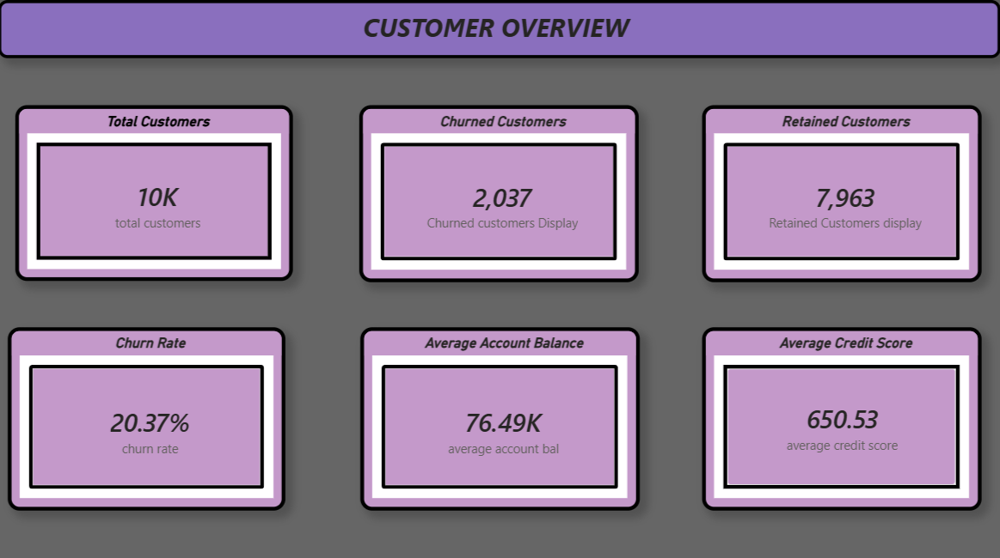
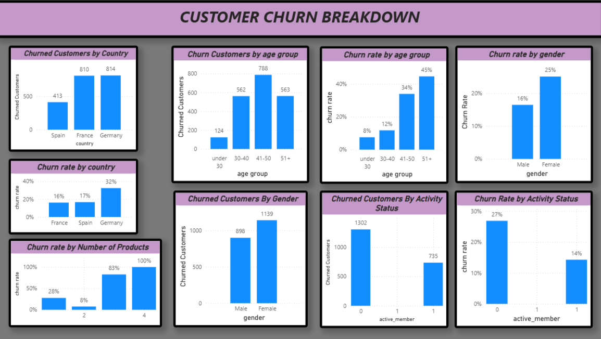
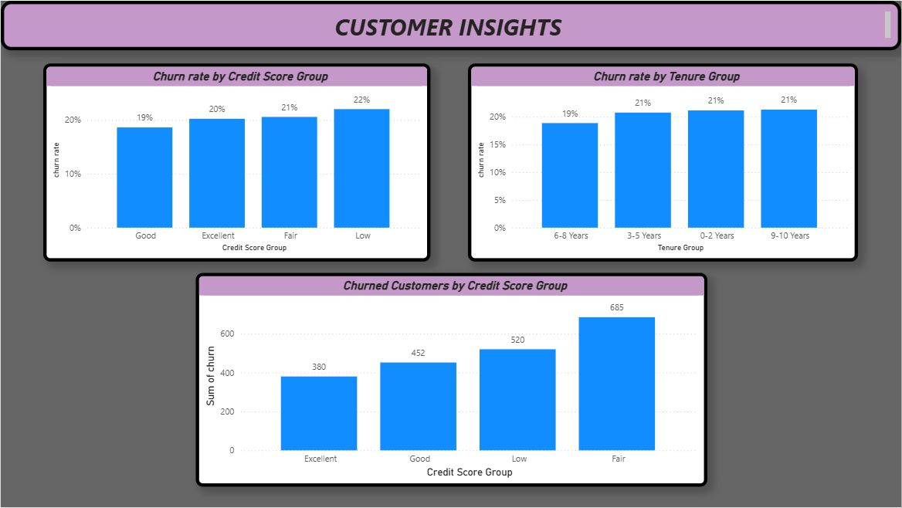

# Bank Customer Churn Analysis

## About the Project

This is a data analytics project where I analyzed a bank customer dataset containing 10,000 records to understand customer churn.

I used Excel to clean the data, MySQL to query and analyze it, and Power BI to create interactive dashboards.

The main goal was to understand which customers were more likely to leave the bank and identify patterns based on age, gender, country, account activity, credit score, and other factors.

## Objectives
- Analyze customer churn and retention.
- Identify customer segments with higher churn rates.
- Examine churn patterns across age groups, gender, countries, and account activity.
- Explore the relationship between churn, credit scores, and the number of products held.
- Present key findings through interactive Power BI dashboards.

## Tools Used
- Microsoft Excel
- MySQL
- Microsoft Power BI
- DAX

## Conclusion
The analysis showed that churn rates varied across different customer groups. Older customers, female customers, and inactive customers had higher churn rates in this dataset. The dashboards helped me understand these patterns and present the findings clearly.

---                  
**Project Type:** Data Analytics                    
**Tools:** Excel | MySQL | Power BI | DAX

## Dashboard Screenshots

### 1. Customer Overview

### 2. Customer Churn Breakdown

### 3. Customer Insights

